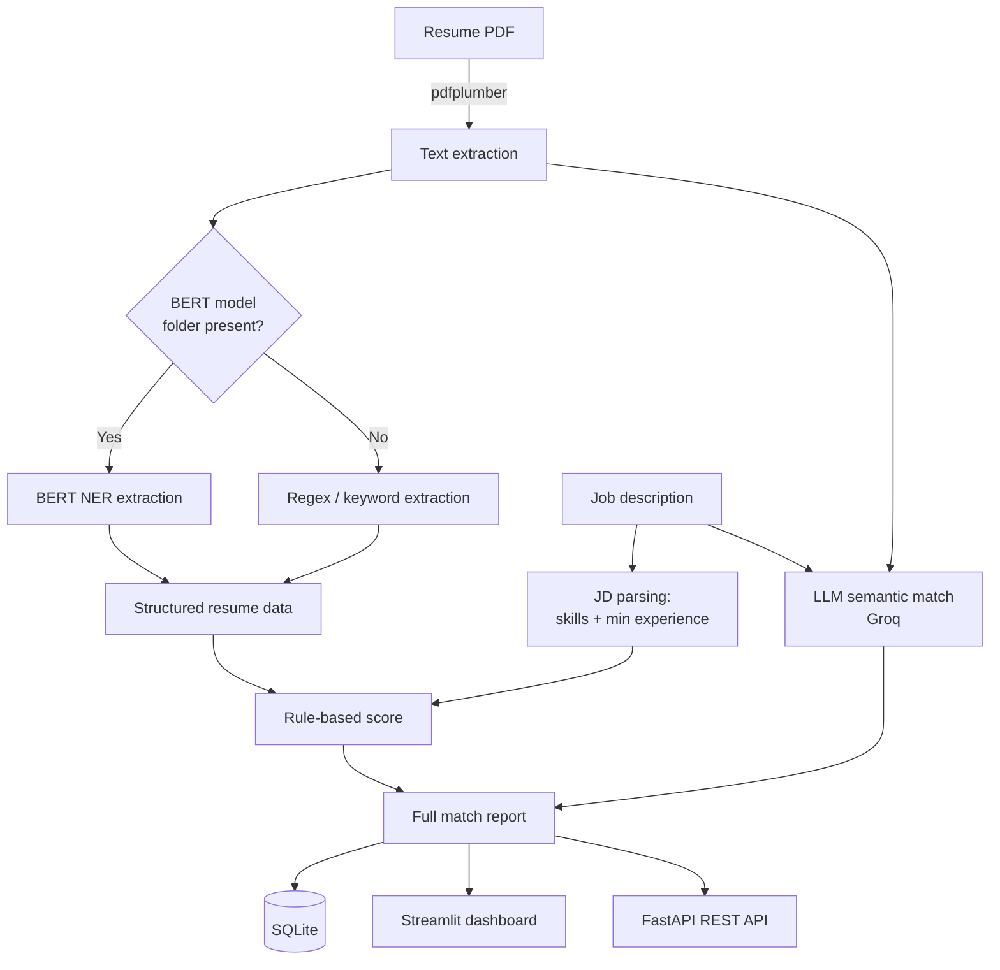

# 📄 ResumeIQ — AI Resume Screener

ResumeIQ reads PDF resumes, matches them against a job description, and scores each candidate two ways: a transparent **rule-based score** and an **LLM semantic evaluation** with a written justification. Upload one resume for a detailed report, or several to rank and shortlist candidates.

---

## 📑 Table of Contents

- [Features](#-features)
- [Tech Stack](#-tech-stack)
- [How It Works](#-how-it-works)
- [Scoring](#-scoring)
- [Project Structure](#-project-structure)
- [Getting Started](#-getting-started)
- [API Reference](#-api-reference)
- [Database](#-database)
- [Deployment](#-deployment)

---

## ✨ Features

- **PDF resume parsing** with `pdfplumber`
- **Entity extraction**: name, email, phone, skills, companies, education and years of experience, using a fine-tuned BERT NER model with an automatic regex/keyword fallback
- **Job description parsing** for required skills and minimum experience
- **Dual scoring**: a reproducible rule-based score (0–100) next to an LLM fit score (1–10)
- **LLM insights**: justification, key strengths, key gaps and a Strong / Moderate / Weak Fit recommendation
- **Batch mode**: upload several resumes to get a ranked shortlist
- **Interactive dashboard**: score gauge, breakdown bars, radar chart, skill donut, and matched / missing / extra skill tabs
- **Evaluation metrics**: precision, recall, F1 and skill-match rate for skills
- **Screening history** saved to SQLite
- **REST API** with FastAPI and Swagger docs
- **Graceful degradation**: if the LLM key is missing or the call fails, the rule-based score and the rest of the app keep working

---

## 🧰 Tech Stack

| Layer | Technologies |
|---|---|
| **UI** | Streamlit, Plotly |
| **API** | FastAPI, Uvicorn |
| **NLP / ML** | Hugging Face Transformers (BERT token classification), PyTorch (CPU) |
| **LLM** | Groq API (`openai/gpt-oss-20b`) |
| **PDF parsing** | pdfplumber |
| **Storage** | SQLite |
| **Language** | Python 3.11 |
| **Hosting** | Render |

---

## ⚙️ How It Works



1. **Extract**: the PDF is converted to plain text.
2. **Understand**: entities are pulled out with the BERT model (if available) or the fallback extractor.
3. **Parse the JD**: required skills and minimum years of experience are identified.
4. **Score**: the rule-based scorer and the LLM evaluate the candidate independently.
5. **Report & store**: both results are shown side by side and saved to the database.

---

## 📊 Scoring

### Rule-based score (0–100)

| Component | Weight | How it's calculated |
|---|---|---|
| **Skills** | 60 | Share of the JD's required skills found in the resume |
| **Experience** | 25 | Candidate years ÷ required years (capped at full marks) |
| **Education** | 15 | Awarded when education details are found |

It is deterministic, fast and explainable, which makes it a reliable baseline for exact skill coverage.

### LLM score (1–10)

The resume (first 6,000 characters) and JD (first 3,000 characters) are sent to the LLM with a recruiter-style prompt. The model returns strict JSON:

```json
{
  "llm_score": 7,
  "justification": "2–4 sentence explanation",
  "key_strengths": ["...", "..."],
  "key_gaps": ["...", "..."],
  "recommendation": "Strong Fit | Moderate Fit | Weak Fit"
}
```

The LLM catches things rules can't, such as transferable skills, seniority and different phrasing for the same skill.

### Why both?

Showing both scores together means neither is a black box. You can see where they agree and where they differ.

---

## 📁 Project Structure

```
resume-iq/
├── app.py               # Streamlit dashboard (single + batch screening)
├── api.py               # FastAPI REST backend
├── backend.py           # PDF extraction, entity extraction, JD parsing, scoring
├── llm_matcher.py       # Groq LLM call, prompt and JSON parsing
├── db.py                # SQLite persistence for screenings
├── datasets.json        # Annotated resume dataset (JSON Lines) for NER training
├── requirements.txt     # Python dependencies
├── runtime.txt          # Python version for deployment
├── render.yaml          # Render deployment config
└── .streamlit/
    └── config.toml      # Streamlit server settings
```

---

## 🚀 Getting Started

### Prerequisites
- Python 3.11
- A free [Groq API key](https://console.groq.com/keys)

### 1. Clone the repository
```bash
git clone https://github.com/nadeem-06/resume-iq.git
cd resume-iq
```

### 2. Create a virtual environment and install dependencies
```bash
python -m venv .venv
source .venv/bin/activate        # Windows: .venv\Scripts\activate
pip install -r requirements.txt
```

### 3. Set your API key
```bash
export GROQ_API_KEY="your-key-here"     # Windows (PowerShell): $env:GROQ_API_KEY="your-key-here"
```

### 4. Run the dashboard
```bash
streamlit run app.py
```
Open `http://localhost:8501`.

### 5. Run the API (optional)
```bash
pip install fastapi uvicorn python-multipart
uvicorn api:app --reload --port 8000
```
Interactive docs are at `http://localhost:8000/docs`.

### Optional: BERT NER model
Place a trained token-classification model in a folder named `my_resume_bert/` in the project root. If the folder isn't there, the app automatically uses the regex/keyword extractor. It still works, with slightly lower precision on unusual resume layouts.

---

## 📡 API Reference

| Method | Endpoint | Description |
|---|---|---|
| GET | `/` | Health check |
| POST | `/api/parse-jd` | Parse a job description. Form field: `jd_text` |
| POST | `/api/screen` | Full screening pipeline. Form fields: `resume` (PDF file), `jd_text` |
| GET | `/api/screenings?limit=25` | List recent screenings, newest first |
| GET | `/api/screenings/{id}` | Get the full stored record for one screening |

**Example**
```bash
curl -X POST http://localhost:8000/api/screen \
  -F "resume=@resume.pdf" \
  -F "jd_text=Looking for a Python developer with 2+ years of FastAPI experience"
```

The response includes `screening_id`, `resume_data`, `job_data`, `rule_score`, `breakdown` and `llm_result`.

---

## 🗄️ Database

Screenings are saved to `resumeiq.db`, which is created automatically on first run. Each row stores:

- Candidate name, email and phone
- Resume text and extracted data
- Job description and parsed requirements
- Rule-based score and breakdown
- LLM score, justification, recommendation and full result

---

## ☁️ Deployment

The repo includes a `render.yaml` for one-click deployment on [Render](https://render.com):

1. Create a new **Blueprint** on Render and connect this repository.
2. Add `GROQ_API_KEY` as an environment variable.
3. Deploy. The service runs `streamlit run app.py` on Render's assigned port.

> Note: SQLite data on Render's free tier is not persistent across redeploys.

---

## 👤 Author

**Nadeem** · [GitHub](https://github.com/nadeem-06)

If you found this project useful, consider giving it a ⭐
